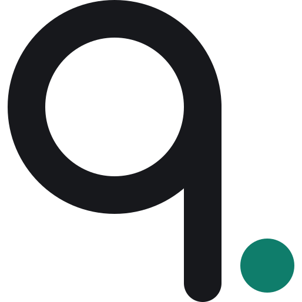

<h1>

  <picture>
    <source media="(prefers-color-scheme: dark)" srcset="docs/images/que-mark-dark.svg">
    
  </picture>
   que
</h1>
  

    <b>Go ahead and log off</b>
     
    que is a macOS app for running coding agents in parallel, with a distraction-free view that lets you unplug and focus while they work.
     
    <a href="#about">About</a>
    ·
    <a href="https://queapp.org/guides/install/">Download</a>
    ·
    <a href="https://queapp.org/guides/overview/">Documentation</a>
    ·
    <a href="CONTRIBUTING.md">Contributing</a>
    ·
    <a href="DEVELOPING.md">Developing</a>
  

## About

que is a macOS app for running coding agents in parallel, each in its own git worktree on its own
branch. It works with Claude Code today. The sessions live in a background daemon, so closing the
window, or quitting the app, ends nothing.

Choose your hours, or start a quiet hour before a meeting, and que goes quiet so you can unplug and
focus while they work. Your sessions keep running, and the window becomes a distraction-free view
that shows only whether each one is running and whether it is stuck. You can still look: an unlock
lasts a few minutes, then quiet comes back on its own, and every unlock shows up in the morning
report.

It works like putting your phone in a box by the door. Nothing is out of reach; reaching for it is
a decision now, not a reflex.

For more, see the [overview](https://queapp.org/guides/overview/) on queapp.org.

## Download

Download the DMG from the [install page](https://queapp.org/guides/install/) on queapp.org, or from
[Releases](https://github.com/queapp-org/que/releases). que needs macOS on Apple Silicon. Builds
are unsigned for now; the install page has the steps for the first launch.

## Documentation

The [guides](https://queapp.org/guides/overview/) on queapp.org cover install, the first run, quiet
mode, configuration and the CLI; the [CLI reference](https://queapp.org/reference/cli/) and the
[configuration reference](https://queapp.org/reference/configuration/) list every command and
every key.

## Contributing and developing

Ideas, issues and pull requests are welcome; [CONTRIBUTING.md](CONTRIBUTING.md) says how.
[DEVELOPING.md](DEVELOPING.md) covers running que from source and how the pieces fit. To report a
vulnerability, see [SECURITY.md](SECURITY.md).

## Roadmap and status

que is in early preview (0.x): used every day by its author, changing fast. What comes next is in
[ROADMAP.md](ROADMAP.md).

## License

[Apache-2.0](LICENSE) © 2026 Ryan Quellhorst
